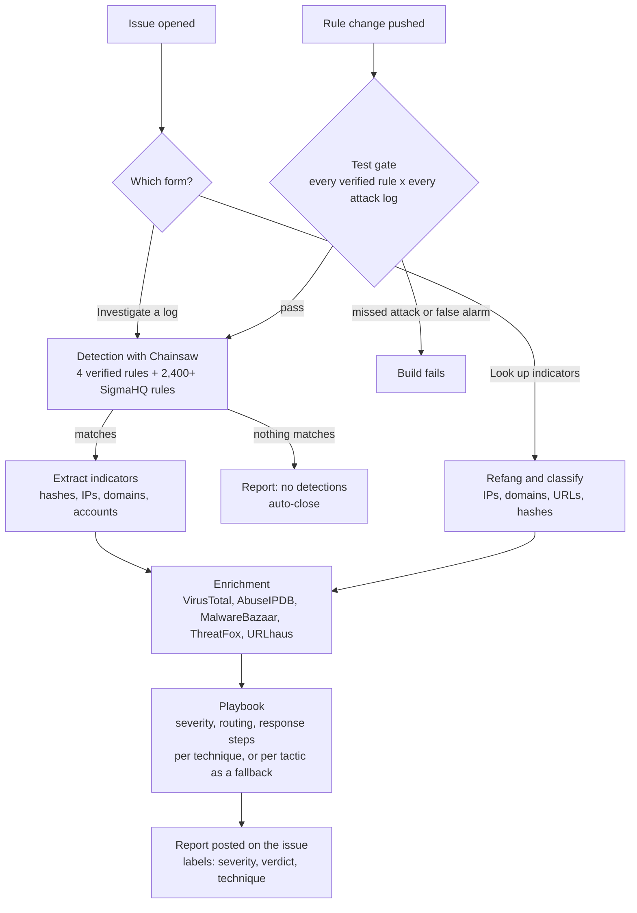

# SOC in a repo

A free mini-SOC that runs entirely on GitHub. Open an issue, and a bot investigates Windows logs or suspicious indicators, enriches what it finds with threat intel, applies a response playbook and posts an incident report. No server, no SIEM, no install.

 

| | What you give it | What you get back |
|---|---|---|
| **Investigate a Windows log** | A zip of `.evtx` logs from a PC (one PowerShell script collects them) | Incident report: verified and community detections, ATT&CK techniques, enriched indicators, severity, routing, response steps |
| **Look up indicators** | IPs, domains, URLs or hashes from a phishing email or alert, defanged or not | Verdict table from VirusTotal, AbuseIPDB, MalwareBazaar, ThreatFox and URLhaus, plus next steps |

## Try the demo

1. **[Investigate a sample attack](https://github.com/w3bcooki3/detection-as-code/issues/new?template=investigate.yml)**: pick *Mimikatz stealing passwords from LSASS* and submit
2. **[Look up indicators](https://github.com/w3bcooki3/detection-as-code/issues/new?template=lookup.yml)**: paste a few IPs or domains and submit

The bot replies on the issue in a few minutes. Sample attacks are real recordings from [EVTX-ATTACK-SAMPLES](https://github.com/sbousseaden/EVTX-ATTACK-SAMPLES). This demo repo is public, so never paste real company data here.

## Use it for real (private copy, about 10 minutes)

1. Click **Use this template > Create a new repository** and choose **Private**. Your logs and cases stay private.
2. Create free API keys at [VirusTotal](https://www.virustotal.com), [AbuseIPDB](https://www.abuseipdb.com) and [abuse.ch](https://auth.abuse.ch), then add them under **Settings > Secrets and variables > Actions** as `VT_API_KEY`, `ABUSEIPDB_API_KEY` and `ABUSECH_AUTH_KEY`.
3. On the Windows PC you want to check, download [`collect.ps1`](collect.ps1) and run it in PowerShell as administrator:
   ```powershell
   powershell -ExecutionPolicy Bypass -File .\collect.ps1 -Days 3
   ```
   It exports the last 3 days of Security, System, Sysmon, PowerShell and Defender logs to a zip on the Desktop. It only reads logs and changes nothing.
4. In your private copy, open **Issues > New issue > Investigate a Windows log**, choose **My own log**, drag the zip in and submit.

Private repos get free GitHub Actions minutes every month, which covers hundreds of investigations.

## Real use case: a password-theft alert at 2 AM

**The situation.** A SOC analyst on night shift gets an EDR alert from a laptop: `rundll32.exe` touched LSASS memory. The file is a signed Windows binary, so the antivirus says nothing. Attack or noise?

**Manually,** the analyst pulls the logs, reads the command line, copies hashes into VirusTotal and MalwareBazaar one by one, looks up the ATT&CK technique, decides the severity, finds the runbook and writes up the ticket. Roughly 20 to 30 minutes, at 2 AM.

**With the bot,** the analyst opens an investigation with the exported log. An excerpt of the real report it posted on [issue #3](https://github.com/w3bcooki3/detection-as-code/issues/3), 17 seconds later:

> **Incident report: CRITICAL**
>
> | | |
> |---|---|
> | Host | `MSEDGEWIN10` |
> | Detection | LSASS Memory Dump via comsvcs.dll MiniDump (T1003.001) |
> | Process | `rundll32.exe` |
> | Routing | escalate to incident response now |
>
> **Threat intel:** `rundll32.exe` hash, VirusTotal **0/75 engines flag it**, not in MalwareBazaar
>
> *Clean file hashes usually mean living off the land: a legitimate Windows binary used for something malicious. The behaviour is the threat, not the file.*
>
> **Recommended response:** isolate the host with your EDR, reset passwords for every account that logged on (starting with admins), hunt for the same command line on other hosts, watch for new logons from these accounts for 72 hours.

**Why it matters.** A hash lookup alone would have called this clean. The detection caught the *behaviour*, the playbook made it a critical case with clear next steps, and the analyst went straight to containment.

| | Manual triage | With the bot |
|---|---|---|
| Time to a verdict | 20 to 30 minutes | under a minute |
| Threat intel lookups | one site at a time | automatic, every indicator |
| Severity and routing | judgment at 2 AM | consistent, from the playbook |
| Write-up | typed by hand | posted on the case, ready for handoff |

## How it works



**Two tiers of detection.** *Verified* rules live in this repo and must pass the test gate: each one has to catch a real attack recording and stay silent on everything else. *Community* rules are the SigmaHQ Windows rule set, pulled fresh on every run for broad coverage. Reports show them separately, and community hits alone can raise a case to *high* at most, never *critical*.

## What it can and can't do

### Capabilities

| Area | Today |
|---|---|
| Input | Zip of up to 10 `.evtx` files (25 MB), one of 5 sample attacks, or a list of indicators |
| Collection | `collect.ps1` exports Security, System, Sysmon, PowerShell and Defender logs for the last N days |
| Detection | 4 verified rules (3 ATT&CK techniques, tested in CI) + 2,400+ SigmaHQ community rules |
| Indicators | SHA256 hashes, IPs, domains and accounts from matching events; refangs `hxxp` and `[.]` in lookups |
| Enrichment | VirusTotal, AbuseIPDB, MalwareBazaar, ThreatFox, URLhaus (free tiers) |
| Decision | Severity from the playbook and rule level, raised one step when threat intel confirms something malicious |
| Response | Routing and containment steps for each technique, with a fallback for each ATT&CK tactic, from `playbooks/response.yml` |
| Case handling | Report on the issue, severity, verdict and technique labels, clean cases closed automatically |
| Quality | Verified rules tested against real attack logs on every push, plus a smoke test of the bot |
| Cost | $0: free GitHub Actions and free API tiers |

### Limitations

- **Windows only.** No Linux, macOS, cloud (AWS, Azure, Microsoft 365), firewall or proxy logs yet.
- **Detection depends on what Windows logged.** Without Sysmon, or with process-creation auditing (event 4688) turned off, many rules have nothing to match. "No detections" means no rule matched, not that the PC is clean.
- **Community rules need review.** SigmaHQ rules are broad and some fire on normal admin activity. That's why they sit in their own tier.
- **Not real time.** Someone runs the collector and opens an issue. It does not connect to a SIEM or EDR.
- **Recommends, does not act.** It never isolates hosts, disables accounts or blocks indicators. A human decides, by design.
- **Free API limits.** VirusTotal allows 4 lookups a minute, so each log case checks at most 8 lookups and each indicator lookup at most 10 indicators.
- **Simple severity logic.** No correlation across cases and no asset context such as "this is a domain controller".
- **Public demo.** Anything posted to this repo is public. Real data belongs in a private copy.

### Roadmap

- More verified rules: RDP brute force, new services, scheduled tasks, shadow copy deletion
- Linux auth logs and Microsoft 365 sign-in logs
- Metrics page: cases per day, time to report, verdict mix
- Correlation between cases that share a host, account or indicator
- Slack or Teams alerts for critical cases

## What the testing caught

- **Blind rule.** The first log-cleared rule never fired. Event 1102 is written by the Eventlog provider, not Security-Auditing, so the log source was wrong. Fixed with `service: eventlog` and `Provider_Name`.
- **The same gap in the community tier.** SigmaHQ's audit-log-cleared rule uses `service: security`, which Chainsaw's default mapping limits to the Security-Auditing provider, so it does not fire on the 1102 sample. The verified rule does. This is the reason for having a tested tier at all.
- **Mislabelled sample.** The LSASS rule fired on a sample labelled "discovery". The hit was `D:\m.exe` (Meterpreter) opening LSASS with `0x1410`, a real credential theft. The rule was right and the sample became a required catch.

## Layout

| Path | What it is |
|---|---|
| `collect.ps1` | Windows log collector: exports and zips the logs the bot needs |
| `rules/` | Verified Sigma rules, tagged with MITRE ATT&CK |
| `playbooks/response.yml` | Severity, routing and containment steps per technique and per tactic |
| `scripts/triage.py` | The bot: detection, indicator extraction, enrichment, playbook, report |
| `scripts/run_tests.py` | Test gate for verified rules, plus Splunk and Elastic query conversion and an ATT&CK layer |
| `tests/` | Which verified rule must fire on which attack log |
| `.github/ISSUE_TEMPLATE/` | The two forms: investigate a log, look up indicators |
| `.github/workflows/` | `triage.yml` runs the bot on new issues, `detections.yml` runs the test gate on every push |

## Guard rails

- At most 25 cases a day, so nobody can burn the free API quotas
- Private IP addresses are never sent to threat intel services
- Uploads: zip only, up to 10 `.evtx` files, 25 MB compressed and 200 MB uncompressed, file names sanitised
- The issue body is parsed as data and never executed

## Credits

Detection engine [Chainsaw](https://github.com/WithSecureLabs/chainsaw) by WithSecure. Community rules from [SigmaHQ](https://github.com/SigmaHQ/sigma) under the Detection Rule License, downloaded at run time and not redistributed here. Attack recordings from [EVTX-ATTACK-SAMPLES](https://github.com/sbousseaden/EVTX-ATTACK-SAMPLES) by Samir Bousseaden.

## License

MIT for the code in this repo. See [LICENSE](LICENSE).
