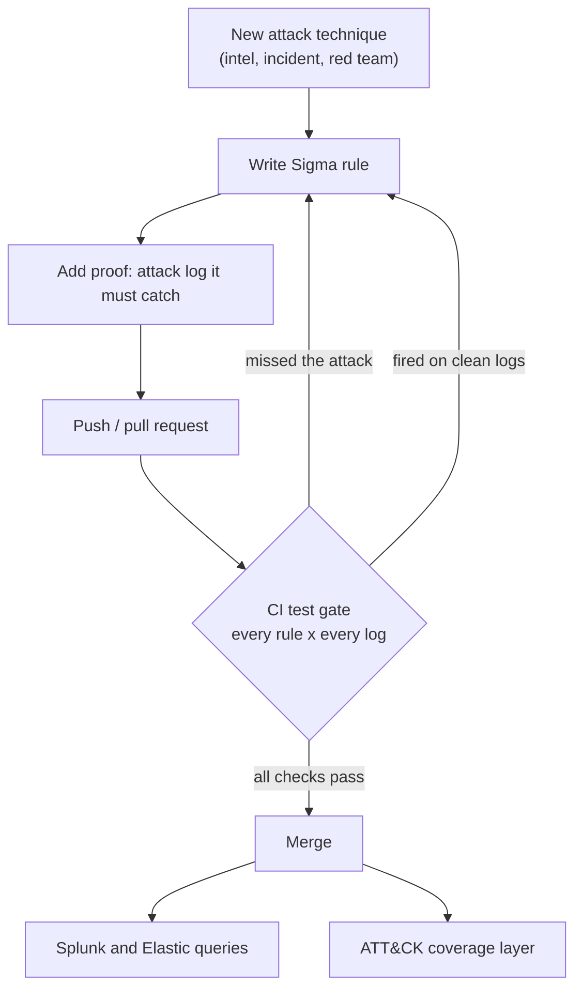

# Detection-as-code

Sigma detection rules that have to prove themselves before they ship. Every rule must catch a real attack recording and stay silent on every other log. GitHub Actions checks this on every push.

## Why

Most detections are written straight into a SIEM console and never tested. A wrong log source makes a rule silently blind, a loose condition makes it so noisy that analysts ignore it, and nobody notices either way. Here every rule lives in Git, ships with proof, and fails the build if it misses its attack or fires on clean logs.

## How it works

## Layout

| Path | What it is |
|---|---|
| `rules/` | One Sigma rule per file, tagged with MITRE ATT&CK |
| `tests/logs.yml` | Test logs, pulled from [EVTX-ATTACK-SAMPLES](https://github.com/sbousseaden/EVTX-ATTACK-SAMPLES) at build time |
| `tests/expected.yml` | Which rule must fire on which log. Every other pair must stay silent |
| `scripts/run_tests.py` | Runs [Chainsaw](https://github.com/WithSecureLabs/chainsaw) for every rule and log, converts rules with pySigma, builds the ATT&CK layer |
| `.github/workflows/detections.yml` | Runs everything on every push |

## Current rules

| Rule | ATT&CK | Must catch |
|---|---|---|
| LSASS memory dump via comsvcs.dll MiniDump | T1003.001 | rundll32 comsvcs MiniDump |
| Suspicious process access to LSASS | T1003.001 | Mimikatz sekurlsa, Meterpreter |
| Security event log cleared (1102) | T1070.001 | Log clear |
| Hidden PowerShell without profile | T1059.001 | PsExec + Meterpreter stager |

4 rules x 8 logs = 32 checks, all passing.

## What the gate caught

- **Blind rule.** The first log-cleared rule never fired. Event 1102 is written by the Eventlog provider, not Security-Auditing, so the log source was wrong. Fixed with `service: eventlog` and `Provider_Name`.
- **Mislabelled sample.** The LSASS rule fired on a sample labelled "discovery". The hit was `D:\m.exe` (Meterpreter) opening LSASS with `0x1410`, a real credential theft. The rule was right, so the sample became a required catch.

## Run locally

    python scripts/fetch_logs.py
    python scripts/run_tests.py path/to/chainsaw path/to/chainsaw/mappings/sigma-event-logs-all.yml

Outputs land in `build/`: test results, SIEM queries and `attack_layer.json` for [ATT&CK Navigator](https://mitre-attack.github.io/attack-navigator/).
