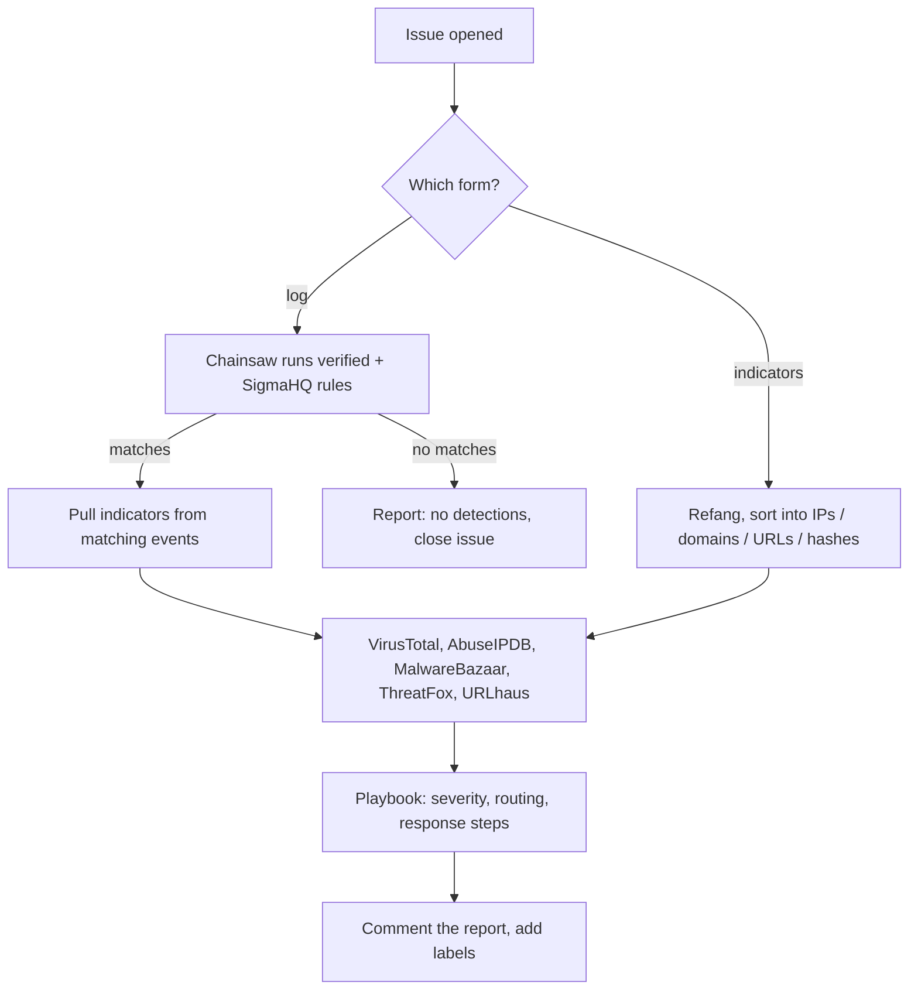

# SOC in a repo


I wanted a way to triage a Windows box without standing up a SIEM, so I built this on top of GitHub Issues and Actions. You open an issue, a workflow runs, and a few minutes later the bot comments with a report.

It does two things:

- **Log investigation.** Give it Windows event logs (zipped `.evtx`). It runs Sigma rules over them with [Chainsaw](https://github.com/WithSecureLabs/chainsaw), pulls out hashes/IPs/domains from whatever matched, checks them against threat intel, and writes up severity, ATT&CK techniques and next steps.
- **Indicator lookup.** Paste IPs, domains, URLs or hashes (defanged is fine) and get a verdict for each from VirusTotal, AbuseIPDB, MalwareBazaar, ThreatFox and URLhaus.

Everything runs on free tiers, so it costs nothing to run.

## Try it

- [Run a sample attack](https://github.com/w3bcooki3/detection-as-code/issues/new?template=investigate.yml) (Mimikatz is a good one to start with)
- [Look up some indicators](https://github.com/w3bcooki3/detection-as-code/issues/new?template=lookup.yml)

The samples are real recordings from [EVTX-ATTACK-SAMPLES](https://github.com/sbousseaden/EVTX-ATTACK-SAMPLES). This repo is public, so please don't post anything real here. Past runs are in the [issues](https://github.com/w3bcooki3/detection-as-code/issues?q=is%3Aissue) if you just want to see the output.

## Using it on your own logs

Make your own private copy and use that.

1. **Use this template > Create a new repository**, set it to Private.
2. Get free API keys from [VirusTotal](https://www.virustotal.com), [AbuseIPDB](https://www.abuseipdb.com) and [abuse.ch](https://auth.abuse.ch). Add them under Settings > Secrets and variables > Actions as `VT_API_KEY`, `ABUSEIPDB_API_KEY` and `ABUSECH_AUTH_KEY`. Without keys it still runs detection, it just skips the lookups.
3. On the Windows machine, open PowerShell as admin and run [`collect.ps1`](collect.ps1):
   ```powershell
   powershell -ExecutionPolicy Bypass -File .\collect.ps1 -Days 3
   ```
   It exports the last 3 days of Security, System, Sysmon, PowerShell and Defender logs to a zip on the Desktop. It only reads, it doesn't change anything.
4. In your copy, open an "Investigate a Windows log" issue, pick "My own log" and drag the zip in.

## An example

Issue [#3](https://github.com/w3bcooki3/detection-as-code/issues/3) is the comsvcs.dll LSASS dump sample. This is the kind of alert that's easy to wave off at 2 AM: `rundll32.exe` is a signed Microsoft binary and its hash is clean on VirusTotal (0/75). The rule fires on the command line instead (`comsvcs.dll, MiniDump`), so the case still comes out critical:

```
Incident report: CRITICAL
Host:       MSEDGEWIN10
Detection:  LSASS Memory Dump via comsvcs.dll MiniDump (T1003.001)
Threat intel: rundll32.exe hash 0/75 on VirusTotal, not in MalwareBazaar
Routing:    escalate to incident response now
Response:   isolate the host, reset passwords for accounts that logged on,
            hunt for the same command line elsewhere, watch those accounts for 72h
```

Doing the same by hand (pull logs, read the command line, look up hashes one site at a time, figure out severity, write the ticket) is easily 20-30 minutes. The bot posted this in 17 seconds.

## How it works



There are two sets of rules:

- `rules/` are mine. Each one has to fire on a specific attack sample and stay quiet on every other sample, and CI fails the build if not (4 rules x 8 logs = 32 checks on every push).
- The SigmaHQ Windows rules (~2,400) get pulled at run time for coverage. They're noisier, so they show up in their own section of the report and can't push a case above "high" on their own.

The response logic lives in `playbooks/response.yml`, not in the code. There's an entry for each technique I've written rules for, plus a fallback per ATT&CK tactic for anything SigmaHQ catches.

## Things the tests caught

These came out of the test runs, and they're why I kept the test gate:

- My first log-cleared rule (event 1102) never fired. 1102 is logged by the Eventlog provider, not Security-Auditing, so I had the wrong log source.
- SigmaHQ's own audit-log-cleared rule has the same problem under Chainsaw's default mapping: it doesn't fire on the 1102 sample. Mine does now.
- The LSASS access rule fired on a sample labelled "discovery". It turned out to be Meterpreter (`D:\m.exe`) opening LSASS with `0x1410`, so the rule was right and the label wasn't.
- ThreatFox's `search_ioc` does substring matching, so `google.com` matched some unrelated URL hosted on Google and got flagged malicious ([#4](https://github.com/w3bcooki3/detection-as-code/issues/4)). It only counts exact matches now.

## Limitations

- Windows logs only.
- It can only see what Windows logged. No Sysmon and no process creation auditing (4688) means a lot of rules have nothing to look at. "No detections" doesn't mean the machine is clean.
- Only 4 rules are actually tested. The SigmaHQ hits need a human to look at them.
- It's not real time and doesn't connect to a SIEM or EDR. Someone has to collect the logs and open the issue.
- It only recommends actions. It won't isolate a host or block anything, on purpose.
- Free API limits: VirusTotal is 4 requests a minute, so it checks at most 8 things per log case and 10 indicators per lookup. Big logs get partial enrichment.
- Severity is simple. No correlation between cases, no idea whether a host is a DC or a laptop.
- Uploads: one zip, up to 10 `.evtx`, 25 MB. Max 25 cases a day so nobody burns through the API quota.

## TODO

- More tested rules (RDP brute force, new services, scheduled tasks, shadow copy deletion)
- Linux auth logs, Microsoft 365 sign-ins
- Link cases that share a host, account or indicator
- Slack/Teams message for critical cases

## Files

```
collect.ps1                 log collector for Windows
rules/                      my tested Sigma rules
playbooks/response.yml      severity, routing and response steps
scripts/triage.py           the bot
scripts/run_tests.py        rule tests + Splunk/Elastic query conversion + ATT&CK layer
tests/                      which rule has to fire on which sample
.github/ISSUE_TEMPLATE/     the two issue forms
.github/workflows/          triage.yml (bot) and detections.yml (tests)
```

## Credits

[Chainsaw](https://github.com/WithSecureLabs/chainsaw) by WithSecure, [SigmaHQ](https://github.com/SigmaHQ/sigma) rules (Detection Rule License, downloaded at run time, not included here), and [EVTX-ATTACK-SAMPLES](https://github.com/sbousseaden/EVTX-ATTACK-SAMPLES) by Samir Bousseaden.

MIT licensed, see [LICENSE](LICENSE).
