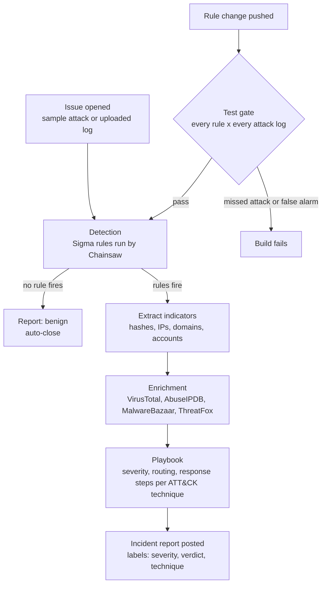

# SOC in a repo

A working mini-SOC that runs entirely on GitHub, for free. Open an issue with a Windows log and a bot detects the attack, enriches what it finds with threat intel, applies a response playbook and posts an incident report.

## Try it (about two minutes)

1. Go to **[New investigation](https://github.com/w3bcooki3/detection-as-code/issues/new?template=investigate.yml)**
2. Pick a sample attack, for example *Mimikatz stealing passwords from LSASS*
3. Submit. The bot replies with an incident report: timeline, ATT&CK techniques, enriched indicators, severity, routing and response steps

Sample attacks are real recordings from [EVTX-ATTACK-SAMPLES](https://github.com/sbousseaden/EVTX-ATTACK-SAMPLES). You can also attach your own zipped `.evtx` from a lab. This repo is public, so never upload logs from a real company.

## Real use case: a password-theft alert at 2 AM

**The situation.** A SOC analyst on night shift gets an EDR alert from a laptop: `rundll32.exe` touched LSASS memory. The file is a signed Windows binary, so the antivirus says nothing. Is this an attack or noise?

**Manually,** the analyst would pull the logs, read the process command line, copy hashes into VirusTotal and MalwareBazaar one by one, look up the ATT&CK technique, decide the severity, find the right runbook and write up the ticket. That's 20 to 30 minutes, at 2 AM, while the attacker keeps moving.

**With this repo,** the analyst opens an investigation with the exported log. This is an excerpt of the real report the bot posted on [issue #3](https://github.com/w3bcooki3/detection-as-code/issues/3), 17 seconds later:

> **Incident report: CRITICAL**
>
> | | |
> |---|---|
> | Host | `MSEDGEWIN10` |
> | Detection | LSASS Memory Dump via comsvcs.dll MiniDump (T1003.001) |
> | Process | `rundll32.exe` |
> | Routing | escalate to incident response now |
>
> **Threat intel:** `rundll32.exe` hash, VirusTotal **0/75 engines flag it**, not in MalwareBazaar
>
> *Clean file hashes here usually mean living off the land: a legitimate Windows binary used for something malicious. The behaviour is the threat, not the file.*
>
> **Recommended response:** isolate the host with your EDR, reset passwords for every account that logged on (starting with admins), hunt for the same command line on other hosts, watch for new logons from these accounts for 72 hours.
>
> Labels added: `severity: critical` `verdict: malicious` `attack: T1003.001`

**Why it matters.** A hash lookup alone would have called this clean (0/75). The detection rule caught the *behaviour*, the playbook turned it into a critical case with clear next steps, and the analyst went straight to containment instead of research.

| | Manual triage | With the bot |
|---|---|---|
| Time to a verdict | 20 to 30 minutes | under a minute |
| Threat intel lookups | copy and paste, one site at a time | automatic, every indicator |
| Severity and routing | analyst judgment at 2 AM | consistent, from the playbook |
| Write-up | typed by hand | posted on the case, ready for handoff |

## How it works

Two loops:

- **Response loop.** Every issue is a case. Detection, enrichment, playbook and report run in GitHub Actions with no server.
- **Engineering loop.** Every rule must catch a real attack and stay silent on everything else before it can reach the bot. 4 rules x 8 logs = 32 checks on every push.

## Layout

| Path | What it is |
|---|---|
| `rules/` | Sigma detection rules, tagged with MITRE ATT&CK |
| `playbooks/response.yml` | Response playbook: severity, routing and containment steps per technique |
| `scripts/triage.py` | The bot: detect, extract indicators, enrich, apply playbook, write the report |
| `scripts/run_tests.py` | Test gate for the rules, plus Splunk and Elastic query conversion and an ATT&CK layer |
| `tests/expected.yml` | Which rule must fire on which attack log |
| `.github/workflows/triage.yml` | Runs the bot when an investigation issue is opened |
| `.github/workflows/detections.yml` | Runs the test gate and a smoke test of the bot on every push |

## Current detections

| Rule | ATT&CK | Playbook severity |
|---|---|---|
| LSASS memory dump via comsvcs.dll MiniDump | T1003.001 | critical |
| Suspicious process access to LSASS | T1003.001 | critical |
| Hidden PowerShell without profile | T1059.001 | high |
| Security event log cleared (1102) | T1070.001 | high |

## What the test gate caught

- **Blind rule.** The first log-cleared rule never fired. Event 1102 is written by the Eventlog provider, not Security-Auditing, so the log source was wrong.
- **Mislabelled sample.** The LSASS rule fired on a sample labelled "discovery". The hit was `D:\m.exe` (Meterpreter) opening LSASS with `0x1410`, a real credential theft. The rule was right and became a required catch.

## Guard rails

- At most 25 investigations a day, so nobody can burn the free API quotas
- Private IP addresses are never sent to threat intel services
- Uploaded files: zip only, one `.evtx`, 20 MB cap, no path traversal
- The issue body is parsed as data and never executed

## Setup for your own copy

Fork it, then add free API keys under **Settings > Secrets and variables > Actions**: `VT_API_KEY` (VirusTotal), `ABUSEIPDB_API_KEY` (AbuseIPDB), `ABUSECH_AUTH_KEY` (abuse.ch). Without keys the bot still detects and reports, and marks enrichment as skipped.
